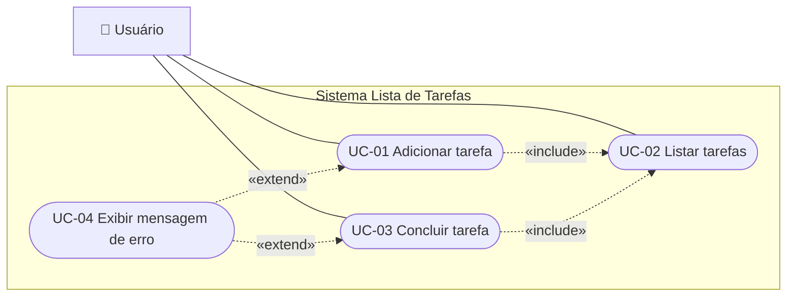
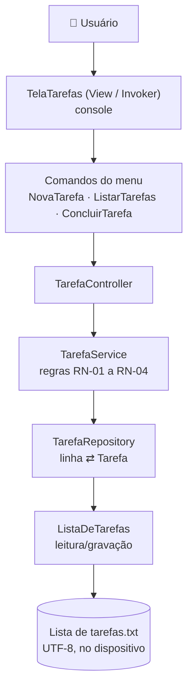
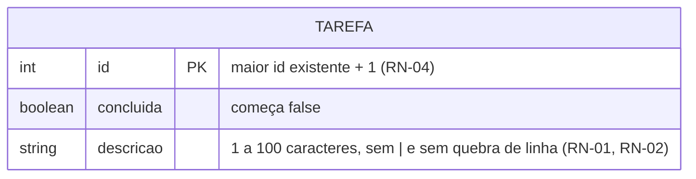
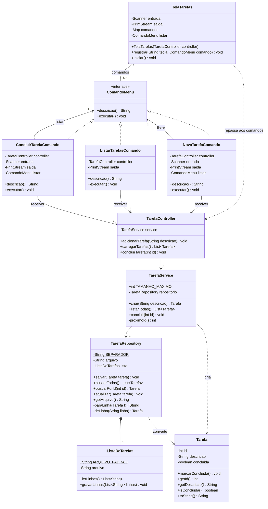
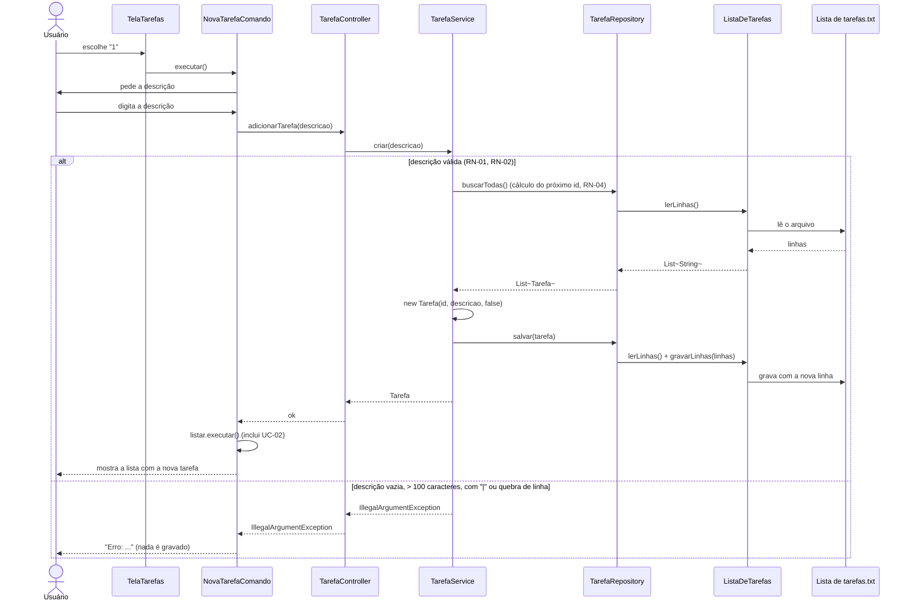
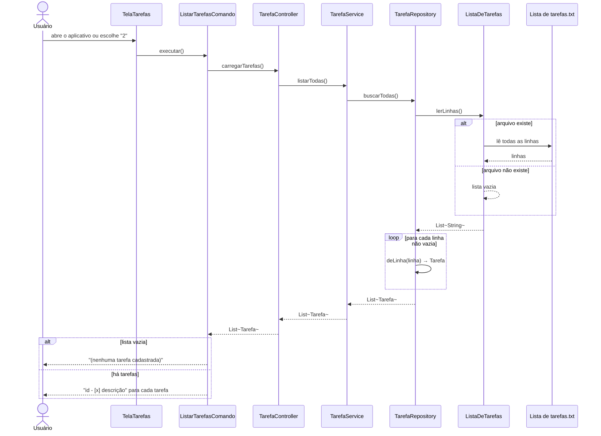
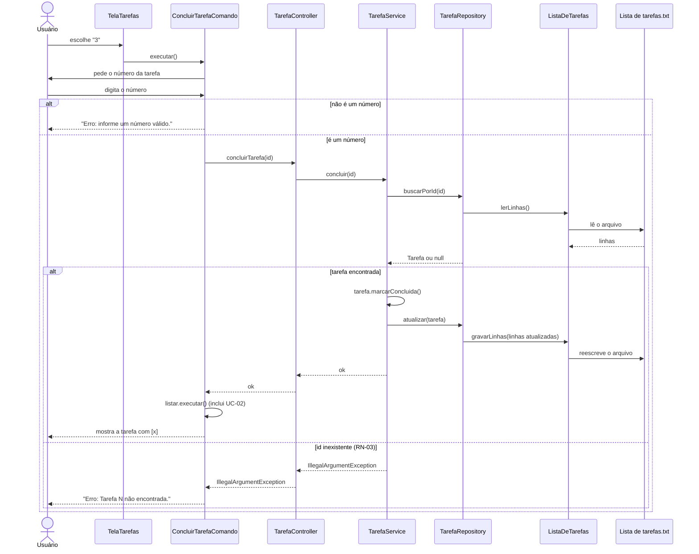
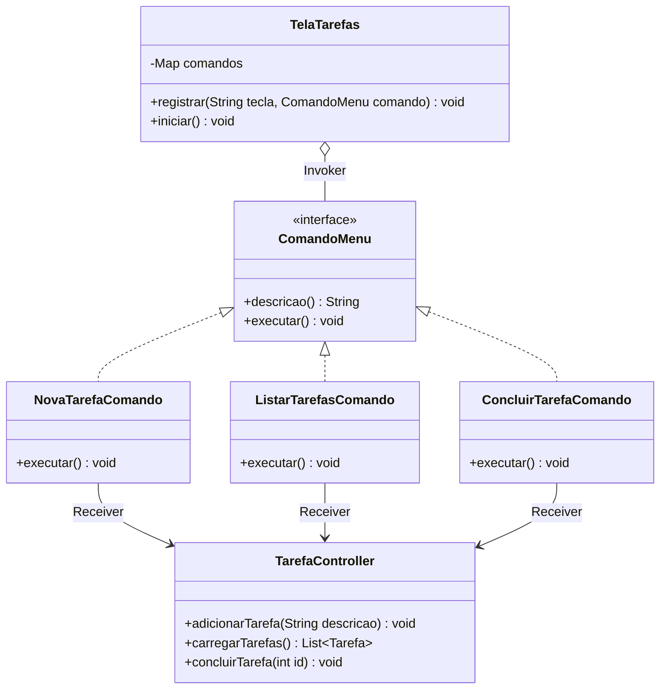

# Documentação do Software — Lista de Tarefas

| Campo | Valor |
|---|---|
| **Versão do documento** | 2.0 |
| **Data** | 27/11/2026 |
| **Autor(es)** | André Vitor Caldas Macedo, Daniel França Ribeiro, Lucas Marques Lucena, Paulo Henrique de Sousa Azevedo, Vinicius Souza Targino |
| **Status** | Em revisão |
| **Aprovado por** | — |

## Histórico de Revisões

| Versão | Data | Autor | Descrição da alteração |
|---|---|---|---|
| 1.0 | 28/08/2026 | Grupo | Criação do documento |
| 2.0 | 27/11/2026 | Grupo | Adequação ao modelo V2: diagrama de casos de uso, padrão GoF Command, diagramas de classes e de sequência atualizados, testes JUnit em 5 classes com cobertura, matriz de rastreabilidade completa. Correção de defeito encontrado no CT-24: acentos digitados no Windows eram lidos como "?" (novo CT-25) |

---

## Sumário

1. [Visão Geral](#1-visão-geral)
2. [Escopo do Projeto](#2-escopo-do-projeto)
3. [Requisitos Funcionais](#3-requisitos-funcionais)
4. [Requisitos Não Funcionais](#4-requisitos-não-funcionais)
5. [Regras de Negócio](#5-regras-de-negócio)
6. [Projeto e Arquitetura do Software](#6-projeto-e-arquitetura-do-software)
7. [Plano e Casos de Teste](#7-plano-e-casos-de-teste)
8. [Matriz de Rastreabilidade](#8-matriz-de-rastreabilidade-requisitos-x-testes-x-código-fonte)
9. [Glossário](#9-glossário)
10. [Anexos e Referências](#10-anexos-e-referências)

---

## 1. Visão Geral

### 1.1 Propósito do documento
Documentar os requisitos, a arquitetura, o projeto, os testes e a rastreabilidade do aplicativo Lista de Tarefas. O documento se destina à equipe de desenvolvimento, a quem fizer os testes (QA) e à professora responsável pela avaliação.

### 1.2 Descrição resumida do sistema
A Lista de Tarefas é um aplicativo local, sem backend, desenvolvido em Java. Nele o usuário cadastra tarefas, consulta a lista e marca tarefas como concluídas. As tarefas ficam gravadas no arquivo de texto `Lista de tarefas.txt` no próprio dispositivo e continuam lá depois que o aplicativo é fechado. Nesta versão, a interface é de console e faz o papel da tela do aplicativo.

### 1.3 Stakeholders

| Nome / Papel | Responsabilidade | Contato |
|---|---|---|
| Product Owner — Grupo | Definição e priorização dos requisitos | — |
| Arquiteto de Software — Grupo | Arquitetura em camadas, pacote por funcionalidade e padrão Command | — |
| Time de Desenvolvimento — André, Daniel, Lucas, Paulo Henrique, Vinicius | Implementação em Java | — |
| Time de QA — Grupo | Testes JUnit e testes manuais | — |
| Cliente / Patrocinador — Profa. Andrea Zotovici | Avaliação e aprovação do documento | — |
| Usuário final | Usa o aplicativo para organizar suas tarefas | — |

---

## 2. Escopo do Projeto

### 2.1 Objetivos do projeto
- Permitir que o usuário cadastre, liste e conclua tarefas de forma simples.
- Manter as tarefas salvas entre uma execução e outra, sem depender de internet ou de servidor.
- Aplicar na prática MVC, organização por funcionalidade, um padrão de projeto GoF e testes unitários com JUnit.

### 2.2 Dentro do escopo (In Scope)
- Adicionar tarefa com descrição (RF-01).
- Listar tarefas, ao abrir o aplicativo e sob demanda (RF-02).
- Marcar tarefa como concluída (RF-03).
- Persistência em arquivo de texto local.
- Validação das entradas do usuário (RN-01 a RN-03).

### 2.3 Fora do escopo (Out of Scope)
- Backend, contas de usuário, login e sincronização entre aparelhos.
- Editar, excluir ou reabrir tarefas.
- Prazos, prioridades, categorias e lembretes.
- Interface gráfica (a versão atual é de console).

### 2.4 Premissas
- O aplicativo roda em um único dispositivo e é usado por uma única pessoa.
- O dispositivo tem JDK 17 ou superior instalado.
- O usuário tem permissão de escrita na pasta em que o aplicativo é executado.

### 2.5 Restrições
- Implementação em Java 17+, com projeto Maven aberto no NetBeans.
- Persistência apenas em arquivo de texto (`Lista de tarefas.txt`), sem banco de dados.
- Prazo: entrega da disciplina no segundo semestre de 2026.

### 2.6 Riscos identificados

| ID | Risco | Probabilidade | Impacto | Mitigação |
|---|---|---|---|---|
| R-01 | Arquivo apagado, ausente ou com linhas em branco | Média | Médio | Arquivo ausente é lido como lista vazia e linhas em branco são ignoradas (CT-14, CT-18) |
| R-02 | Arquivo grande deixa as operações lentas, porque o arquivo inteiro é relido a cada operação | Baixa | Baixo | Desempenho medido com 1.000 tarefas (CT-09); evoluir para banco local (SQLite) se necessário |
| R-03 | Descrição com o separador `\|` ou com quebra de linha corrompe o formato do arquivo | Média | Alto | Proibido pela RN-02 e validado no `TarefaService` (CT-06) |
| R-04 | Terminal envia o texto digitado numa codificação diferente da que o Java usa (ex.: Windows-1252 × UTF-8), estragando acentos | Alta | Médio | Ocorreu no CT-24; corrigido lendo o teclado na codificação do sistema (CT-25) |

### 2.7 Entregáveis
- Projeto NetBeans/Maven com o código-fonte e os testes JUnit.
- Este documento, com os diagramas de casos de uso, arquitetura, classes e sequência.
- Diagrama de containers (`Conteiners.drawio`) e diagrama de casos de uso editável (`CasosDeUso.drawio`).

---

## 3. Requisitos Funcionais

> Requisitos funcionais descrevem **o que** o sistema deve fazer.

### Convenção de ID
`RF-XX` (Requisito Funcional número XX)

### 3.1 Lista de Requisitos Funcionais

| ID | Descrição | Prioridade | Origem / Solicitante | Status |
|---|---|---|---|---|
| RF-01 | O sistema deve permitir adicionar uma tarefa informando uma descrição. | Alta | Enunciado do projeto (disciplina) | Implementado |
| RF-02 | O sistema deve listar as tarefas cadastradas ao abrir o aplicativo e sempre que o usuário pedir. | Alta | Enunciado do projeto (disciplina) | Implementado |
| RF-03 | O sistema deve permitir marcar uma tarefa como concluída, informando seu número. | Alta | Enunciado do projeto (disciplina) | Implementado |

### 3.2 Detalhamento dos Requisitos

#### RF-01 — Adicionar tarefa
- **Descrição:** o usuário cadastra uma nova tarefa informando a descrição. A tarefa recebe um número (id) e começa como não concluída.
- **Ator(es):** Usuário
- **Pré-condições:** aplicativo aberto, com o menu exibido.
- **Fluxo principal:**
  1. O usuário escolhe a opção "1 - Nova tarefa".
  2. O sistema pede a descrição.
  3. O usuário digita a descrição.
  4. O sistema valida a descrição (RN-01, RN-02), gera o id (RN-04) e grava a tarefa no arquivo.
  5. O sistema exibe a lista atualizada (inclui UC-02).
- **Fluxos alternativos / exceções:**
  - Descrição vazia → o sistema exibe "A descrição da tarefa não pode ser vazia." e não grava nada.
  - Descrição com mais de 100 caracteres, com `|` ou com quebra de linha → o sistema exibe a mensagem de erro correspondente e não grava nada.
- **Pós-condições:** a nova tarefa está no arquivo `Lista de tarefas.txt`, não concluída.
- **Critérios de aceite:**
  - [x] A tarefa nova aparece na lista com `[ ]` e o próximo id disponível.
  - [x] Descrição vazia ou inválida é rejeitada com mensagem clara e nada é gravado.
- **Requisitos relacionados:** RN-01, RN-02, RN-04, RNF-05, RNF-06

#### RF-02 — Listar tarefas
- **Descrição:** o sistema mostra todas as tarefas na ordem de criação, indicando quais estão concluídas.
- **Ator(es):** Usuário
- **Pré-condições:** nenhuma (o arquivo pode não existir).
- **Fluxo principal:**
  1. O usuário abre o aplicativo ou escolhe a opção "2 - Listar tarefas".
  2. O sistema lê o arquivo e converte cada linha em uma tarefa.
  3. O sistema exibe cada tarefa no formato `id - [x] descrição`.
- **Fluxos alternativos / exceções:**
  - Arquivo inexistente ou vazio → o sistema exibe "(nenhuma tarefa cadastrada)".
- **Pós-condições:** nenhuma alteração nos dados.
- **Critérios de aceite:**
  - [x] As tarefas aparecem na ordem de criação, com `[x]` para concluída e `[ ]` para pendente.
  - [x] Sem tarefas, é exibida a mensagem "(nenhuma tarefa cadastrada)".
- **Requisitos relacionados:** RNF-01, RNF-02

#### RF-03 — Concluir tarefa
- **Descrição:** o usuário marca uma tarefa existente como concluída.
- **Ator(es):** Usuário
- **Pré-condições:** existir ao menos uma tarefa cadastrada.
- **Fluxo principal:**
  1. O usuário escolhe a opção "3 - Marcar tarefa como concluída".
  2. O sistema pede o número da tarefa.
  3. O usuário digita o número.
  4. O sistema busca a tarefa, marca como concluída e reescreve o arquivo.
  5. O sistema exibe a lista atualizada (inclui UC-02).
- **Fluxos alternativos / exceções:**
  - Texto que não é número → "Erro: informe um número válido."
  - Número de tarefa inexistente → "Erro: Tarefa N não encontrada." (RN-03)
- **Pós-condições:** a tarefa fica concluída no arquivo e continua assim depois de reabrir o aplicativo.
- **Critérios de aceite:**
  - [x] A tarefa aparece com `[x]` e continua concluída após reabrir o aplicativo.
  - [x] Número inválido ou inexistente gera mensagem de erro e não altera o arquivo.
- **Requisitos relacionados:** RN-03, RNF-02, RNF-05

---

## 4. Requisitos Não Funcionais

> Requisitos não funcionais descrevem **como** o sistema deve se comportar. As categorias seguem o modelo de qualidade da **ISO/IEC 25010**, complementado pela análise de **conformidade legal (LGPD)**.

### Convenção de ID
`RNF-XX` (Requisito Não Funcional número XX)

### 4.1 Categorias segundo ISO/IEC 25010

| Característica ISO 25010 | Subcaracterísticas | Descrição |
|---|---|---|
| **Adequação Funcional** | Completude, Corretude, Pertinência funcional | O quanto o sistema atende às funções especificadas e às necessidades reais. |
| **Eficiência de Desempenho** | Comportamento temporal, Utilização de recursos, Capacidade | Desempenho relativo à quantidade de recursos usados (tempo de resposta, throughput, uso de CPU/memória). |
| **Compatibilidade** | Coexistência, Interoperabilidade | Capacidade de coexistir com outros sistemas e trocar informações com eles. |
| **Usabilidade** | Reconhecibilidade, Aprendizagem, Operabilidade, Proteção contra erros, Estética, Acessibilidade | Facilidade de uso e aprendizado pelo usuário. |
| **Confiabilidade** | Maturidade, Disponibilidade, Tolerância a falhas, Recuperabilidade | Capacidade de manter um nível de desempenho sob condições especificadas. |
| **Segurança** | Confidencialidade, Integridade, Não repúdio, Responsabilização (accountability), Autenticidade | Proteção de informações e dados contra acesso não autorizado. |
| **Manutenibilidade** | Modularidade, Reusabilidade, Analisabilidade, Modificabilidade, Testabilidade | Facilidade de modificar e evoluir o software. |
| **Portabilidade** | Adaptabilidade, Instalabilidade, Substituibilidade | Facilidade de transferir o software entre ambientes. |

### 4.2 Lista de Requisitos Não Funcionais

| ID | Característica ISO 25010 | Subcaracterística | Descrição | Critério de aceite / Métrica | Prioridade |
|---|---|---|---|---|---|
| RNF-01 | Eficiência de Desempenho | Comportamento temporal | Listar, adicionar e concluir tarefas deve ser imediato para uso pessoal. | Listar + adicionar + concluir com 1.000 tarefas em ≤ 1 s (CT-09) | Média |
| RNF-02 | Confiabilidade | Recuperabilidade | As tarefas devem permanecer após fechar e reabrir o aplicativo. | Dados relidos do arquivo na abertura, com status preservado (CT-10) | Alta |
| RNF-03 | Manutenibilidade | Modularidade / Testabilidade | Código em camadas (View, Controller, Service, Repository, Entity), organizado por funcionalidade e coberto por testes. | Testes em ≥ 3 classes; cobertura de linhas ≥ 80% (medido: 82,4%) | Alta |
| RNF-04 | Portabilidade | Adaptabilidade | O aplicativo deve rodar em qualquer sistema com JDK 17+, lendo o teclado na codificação do sistema e gravando o arquivo sempre em UTF-8. | Acentos preservados no arquivo (CT-19) e na digitação (CT-25); execução no Windows (CT-24) | Média |
| RNF-05 | Usabilidade | Proteção contra erros | Entradas inválidas geram mensagem clara, sem encerrar o aplicativo. | Mensagens exibidas e menu continua (CT-21, CT-22) | Média |
| RNF-06 | Segurança | Integridade | A descrição digitada não pode corromper o formato do arquivo. | Descrições com `\|` ou quebra de linha rejeitadas (CT-06) | Alta |
| RNF-07 | Compatibilidade | Interoperabilidade | O arquivo de dados deve ser texto simples, legível e editável em qualquer editor. | Formato `id\|concluida\|descricao`, uma tarefa por linha (CT-11) | Baixa |
| RNF-08 | Adequação Funcional | Completude | Todas as funções do escopo (RF-01 a RF-03) devem estar implementadas e testadas. | 100% dos RFs com teste aprovado (matriz, Cap. 8) | Alta |

### 4.3 Conformidade com a LGPD (Lei nº 13.709/2018)

O aplicativo é local e de usuário único. Ele não coleta dados de terceiros, não tem cadastro nem login e não transmite nada pela rede. O único dado pessoal possível é algo que o próprio usuário decida escrever na descrição de uma tarefa. Esse dado fica somente no dispositivo dele, para uso particular. Nessa situação, a LGPD não se aplica: o **Art. 4º, I** exclui o tratamento realizado por pessoa natural para fins exclusivamente particulares e não econômicos. Mesmo assim, o projeto adota por decisão de design os princípios abaixo.

| ID | Princípio / Exigência LGPD | Descrição | Critério de aceite | Prioridade |
|---|---|---|---|---|
| RNF-L03 | Minimização de dados | O sistema guarda apenas id, status e descrição da tarefa; não pede nome, e-mail nem outro dado do usuário. | Formato do arquivo contém só os 3 campos (CT-11) | Média |
| RNF-L09 | Privacy by Design / by Default | Os dados ficam apenas no dispositivo; não há envio pela rede nem compartilhamento. | Ausência de qualquer integração externa (seção 6.12) | Média |
| RNF-L01, L02, L04 a L08, L10 | Finalidade, consentimento, direitos do titular, segurança, retenção, registro, incidentes, transferência internacional | Não se aplicam: não há tratamento de dados de terceiros por um controlador (Art. 4º, I). O próprio usuário pode ler, editar ou apagar o arquivo a qualquer momento. | — | — |

**Papéis relevantes (LGPD):** como o uso é exclusivamente particular, não há controlador, operador nem encarregado (DPO) neste sistema. Se o aplicativo passar a ter backend ou contas de usuário, os requisitos RNF-L01 a RNF-L10 do modelo precisarão ser reavaliados.

### 4.4 Mapeamento RNF × ISO 25010 × LGPD

| ID | Categoria | Referência normativa | Requisito(s) funcional(is) relacionado(s) |
|---|---|---|---|
| RNF-01 | Eficiência de Desempenho | ISO/IEC 25010 | RF-01, RF-02, RF-03 |
| RNF-02 | Confiabilidade | ISO/IEC 25010 | RF-01, RF-03 |
| RNF-05 | Usabilidade | ISO/IEC 25010 | RF-01, RF-03 |
| RNF-06 | Segurança (Integridade) | ISO/IEC 25010 | RF-01 |
| RNF-L03 | Adequação Funcional / Segurança | LGPD Art. 6º, III (necessidade) | RF-01 |
| RNF-L09 | Segurança | LGPD Art. 46, §2º (desde a concepção) | RF-01, RF-02, RF-03 |

---

## 5. Regras de Negócio

> Regras de negócio são políticas, restrições ou lógicas que devem ser respeitadas em todo o sistema.

### Convenção de ID
`RN-XX` (Regra de Negócio número XX)

### 5.1 Lista de Regras de Negócio

| ID | Descrição | Origem | Requisitos relacionados |
|---|---|---|---|
| RN-01 | A descrição da tarefa não pode ser vazia nem conter só espaços. | Definição do grupo | RF-01 |
| RN-02 | A descrição tem no máximo 100 caracteres e não pode conter `\|` nem quebra de linha, porque esses caracteres são os separadores do arquivo. | Definição do grupo (formato do arquivo) | RF-01, RNF-06 |
| RN-03 | Só é possível concluir uma tarefa que exista. | Definição do grupo | RF-03 |
| RN-04 | O id da nova tarefa é o maior id existente + 1, e toda tarefa nasce não concluída. | Definição do grupo | RF-01 |

---

## 6. Projeto e Arquitetura do Software

### 6.1 Diagrama de casos de uso

O ator único é o **Usuário**. Depois de adicionar ou concluir uma tarefa, o sistema sempre mostra a lista atualizada. Por isso, UC-01 e UC-03 **incluem** UC-02. A mensagem de erro só aparece quando a entrada é inválida, então ela **estende** UC-01 e UC-03. Uma versão editável está no arquivo `CasosDeUso.drawio`.



**Descrição dos atores**

| Ator | Descrição | Casos de uso associados |
|---|---|---|
| Usuário | Pessoa que usa o aplicativo para organizar as próprias tarefas. Não existe perfil de administrador. | UC-01, UC-02, UC-03 |

**Lista de casos de uso**

| ID | Caso de uso | Ator(es) | Requisito(s) funcional(is) relacionado(s) |
|---|---|---|---|
| UC-01 | Adicionar tarefa | Usuário | RF-01 |
| UC-02 | Listar tarefas | Usuário | RF-02 |
| UC-03 | Concluir tarefa | Usuário | RF-03 |
| UC-04 | Exibir mensagem de erro (estende UC-01 e UC-03 quando a entrada é inválida) | Usuário | RF-01, RF-03 (RN-01, RN-02, RN-03) |

---

### 6.2 Visão arquitetural
O sistema é um **monolito**: um único executável, sem backend, que roda inteiro no dispositivo do usuário. Internamente, ele está organizado em **camadas** no estilo **MVC** (View → Controller → Service → Repository → arquivo) e em **pacote por funcionalidade** (tudo de "tarefas" fica no pacote `br.fatec.listatarefas.tarefas`). Escolhemos o monolito porque o escopo é pequeno, o uso é por uma pessoa em um dispositivo e um único executável é mais simples de desenvolver e entregar. Na camada de View, as opções do menu seguem o padrão GoF **Command** (seção 6.9).

### 6.3 Diagrama de arquitetura (visão geral)



O diagrama de containers do grupo (`Conteiners.drawio`) mostra a mesma estrutura no nível de containers: o aplicativo Java e o arquivo `.txt`.

### 6.4 Componentes / Módulos

| Componente | Responsabilidade | Tecnologia |
|---|---|---|
| View (`TelaTarefas`) | Mostra o menu e a lista, lê a entrada do usuário e executa o comando escolhido | Java (console, `Scanner`/`PrintStream`) |
| Comandos (`ComandoMenu` e implementações) | Cada opção do menu encapsulada como objeto (padrão Command) | Java |
| Controller (`TarefaController`) | Recebe as ações da View e repassa ao Service, sem regra de negócio | Java |
| Service (`TarefaService`) | Regras de negócio RN-01 a RN-04 | Java |
| Repository (`TarefaRepository`) | Converte linhas do arquivo em `Tarefa` e vice-versa | Java |
| Persistência (`ListaDeTarefas`) | Lê e grava as linhas do arquivo de texto | Java NIO (`Files`) |
| Model (`Tarefa`) | Entidade com id, descrição e status | Java |

Não há serviço de autenticação: o aplicativo é de usuário único e local.

### 6.5 Stack tecnológica

| Camada | Tecnologia / Ferramenta | Versão |
|---|---|---|
| Linguagem / Front-end (console) | Java | 17+ (testado em 21) |
| Back-end | Não há (aplicativo local) | — |
| Banco de Dados | Arquivo de texto UTF-8 | — |
| Build / IDE | Maven / NetBeans | 3.9 / 17+ |
| Testes | JUnit Jupiter (JUnit 5) | 5.10.2 |
| Cobertura | JaCoCo | 0.8.12 |
| Infraestrutura / Cloud | Não há (execução local) | — |
| CI/CD | Não há; testes executados com `mvn test` | — |

### 6.6 Modelo de dados
Não há banco de dados. A única entidade persistida é a **Tarefa**, gravada no arquivo `Lista de tarefas.txt`, uma por linha, no formato `id|concluida|descricao`. Exemplo: `1|true|Estudar UML`.



### 6.7 Diagrama de classes



Notas:
- O atributo `comandos` é um `Map<String, ComandoMenu>`, que associa a tecla do menu ao comando.
- `TarefaRepository` compõe `ListaDeTarefas`: cria a instância no próprio construtor, e ela não existe fora dele.
- A classe `Main` só monta os objetos (Repository → Service → Controller → Tela) e foi omitida do diagrama.

**Descrição das principais classes**

| Classe | Responsabilidade | Requisito(s) relacionado(s) |
|---|---|---|
| TelaTarefas | View de console e Invoker do padrão Command: exibe o menu e executa o comando escolhido | RF-01, RF-02, RF-03, RNF-05 |
| ComandoMenu | Interface Command: contrato comum de todas as opções do menu | RNF-03 |
| NovaTarefaComando | Comando da opção "Nova tarefa" | RF-01, RN-01, RN-02 |
| ListarTarefasComando | Comando da opção "Listar tarefas"; também é usado depois de adicionar e de concluir | RF-02 |
| ConcluirTarefaComando | Comando da opção "Concluir tarefa"; trata número inválido | RF-03, RN-03, RNF-05 |
| TarefaController | Repassa as ações ao Service (Receiver dos comandos) | RF-01, RF-02, RF-03 |
| TarefaService | Regras de negócio e geração de id | RN-01, RN-02, RN-03, RN-04 |
| TarefaRepository | Conversão entre linha do arquivo e `Tarefa` | RF-01, RF-02, RF-03, RNF-02 |
| ListaDeTarefas | Leitura e gravação do arquivo em UTF-8 | RNF-02, RNF-04 |
| Tarefa | Entidade: id, descrição e status | RF-01, RF-03, RN-04 |

---

### 6.8 Diagrama de sequência

**Diagrama de sequência — UC-01: Adicionar tarefa (RF-01)**



**Diagrama de sequência — UC-02: Listar tarefas (RF-02)**



**Diagrama de sequência — UC-03: Concluir tarefa (RF-03)**



---

### 6.9 Padrões de projeto (GoF) utilizados

| Padrão GoF | Categoria | Problema que resolve no projeto | Classes / arquivos envolvidos |
|---|---|---|---|
| Command | Comportamental | O menu era um `switch` que misturava exibição, leitura da entrada e chamada de cada ação. Para adicionar uma opção, era preciso alterar o laço principal da tela. | `tarefas/ComandoMenu.java`, `NovaTarefaComando.java`, `ListarTarefasComando.java`, `ConcluirTarefaComando.java`, `TelaTarefas.java` |

#### Padrão 1 — Command

- **Categoria:** Comportamental
- **Intenção do padrão:** transformar um pedido (uma ação) em um objeto. Assim, quem dispara a ação não precisa saber o que ela faz nem quem a executa de fato.
- **Motivação / contexto no projeto:** cada opção do menu ("Nova tarefa", "Listar tarefas", "Concluir tarefa") tem a sua própria lógica de leitura de entrada, chamada ao controller e tratamento de erro. Com o `switch`, a `TelaTarefas` concentrava tudo isso, e qualquer opção nova obrigava a mexer no laço do menu. Com o Command, a tela guarda os comandos em um `Map` (tecla → comando), monta o menu a partir das descrições e só chama `executar()`.
- **Alternativas consideradas:**
  - *Manter o `switch`:* é mais simples, mas acopla a tela a todas as ações e cresce a cada opção nova.
  - *Strategy:* não se encaixa, porque as opções não são algoritmos intercambiáveis para a mesma tarefa, e sim ações diferentes disparadas pelo usuário.
  - *Observer (para atualizar a lista):* resolveria só a atualização da lista, não a organização do menu.
- **Participantes (mapeamento para o projeto):**

  | Papel no padrão | Classe no projeto |
  |---|---|
  | Command | `ComandoMenu` (interface) |
  | ConcreteCommand | `NovaTarefaComando`, `ListarTarefasComando`, `ConcluirTarefaComando` |
  | Invoker | `TelaTarefas` (guarda os comandos e chama `executar()`) |
  | Receiver | `TarefaController` (quem realmente realiza a ação) |
  | Client | Construtor de `TelaTarefas` (cria os comandos e os registra) |

- **Diagrama de classes do padrão:**



- **Trecho de código ilustrativo (código real do projeto):**

```java
// ComandoMenu.java — Command
public interface ComandoMenu {
    String descricao();
    void executar();
}

// TelaTarefas.java — Invoker: registra e executa, sem saber o que cada comando faz
registrar("1", new NovaTarefaComando(controller, entrada, saida, listar));
registrar("2", listar);
registrar("3", new ConcluirTarefaComando(controller, entrada, saida, listar));
...
ComandoMenu comando = comandos.get(opcao);
if (comando == null) {
    saida.println("Opção inválida.");
} else {
    comando.executar();
}

// NovaTarefaComando.java — ConcreteCommand chamando o Receiver
public void executar() {
    saida.print("Descrição: ");
    try {
        controller.adicionarTarefa(entrada.nextLine());
        listar.executar();
    } catch (IllegalArgumentException e) {
        saida.println("Erro: " + e.getMessage());
    }
}
```

- **Benefícios obtidos e consequências (trade-offs):**
  - *Benefícios:* uma opção nova entra no menu com uma classe nova e uma chamada a `registrar()`, sem alterar o laço do menu (aberto/fechado). Esse comportamento é verificado pelo CT-23. Cada comando é testável isoladamente, simulando a entrada com um `ByteArrayInputStream` (CT-20 a CT-23). O comando de listar é reaproveitado depois de adicionar e de concluir.
  - *Consequências:* o projeto passa a ter quatro classes a mais. Para um menu de três opções, isso é mais código do que o `switch`, e esse custo só se paga quando o menu cresce (por exemplo, com "editar" e "excluir").

---

### 6.10 Decisões de arquitetura (ADR resumido)

| ID | Decisão | Contexto | Alternativas consideradas | Justificativa |
|---|---|---|---|---|
| ADR-01 | Monolito sem backend | Uso pessoal, um usuário, um dispositivo | Microsserviços; cliente + API | Escopo pequeno; um único executável é mais simples de construir, testar e entregar |
| ADR-02 | Persistir em arquivo `.txt` | O enunciado pede persistência simples e local | Banco local (SQLite); serialização Java | Simplicidade e arquivo legível por humanos (RNF-07); risco de desempenho aceito (R-02) |
| ADR-03 | Pacote por funcionalidade | Organização do código-fonte | Pacote por camada (`controller/`, `service/`…) | Tudo de "tarefas" fica junto, o que facilita encontrar e evoluir |
| ADR-04 | Padrão Command no menu | O menu em `switch` acoplava a tela a todas as ações | Manter o `switch`; Strategy | Opções desacopladas, testáveis e extensíveis (seção 6.9) |
| ADR-05 | Gravar o arquivo sempre em UTF-8 e ler o teclado na codificação do sistema | A codificação muda entre Windows e Linux, e o terminal do Windows/NetBeans envia o texto em Windows-1252 | Usar o padrão do Java (UTF-8) em tudo | Mesmo arquivo legível em qualquer sistema e acentos preservados na digitação e no arquivo (RNF-04, CT-19, CT-25) |

### 6.11 Estrutura de pastas do projeto

```
ListaDeTarefas/
  pom.xml                                   build Maven (JUnit 5, JaCoCo)
  README.md
  src/main/java/br/fatec/listatarefas/
    Main.java                               monta Repository -> Service -> Controller -> Tela
    tarefas/
      TelaTarefas.java                      View / Invoker (Command)
      ComandoMenu.java                      Command (interface)
      NovaTarefaComando.java                ConcreteCommand — RF-01
      ListarTarefasComando.java             ConcreteCommand — RF-02
      ConcluirTarefaComando.java            ConcreteCommand — RF-03
      TarefaController.java                 Controller (Receiver)
      TarefaService.java                    Service — RN-01 a RN-04
      TarefaRepository.java                 Repository
      ListaDeTarefas.java                   leitura/gravação do .txt
      Tarefa.java                           Entity
  src/test/java/br/fatec/listatarefas/tarefas/
    TarefaServiceTest.java                  CT-01 a CT-10
    TarefaRepositoryTest.java               CT-11 a CT-14
    TarefaTest.java                         CT-15 a CT-17
    ListaDeTarefasTest.java                 CT-18, CT-19
    ComandosMenuTest.java                   CT-20 a CT-23, CT-25
  docs/
    Documentacao_Lista_de_Tarefas.md        este documento
```

### 6.12 Integrações externas

| Sistema externo | Finalidade | Protocolo | Observações |
|---|---|---|---|
| — | — | — | Não há integrações externas. O aplicativo não acessa rede, APIs nem banco de dados; a única dependência é o sistema de arquivos local. |

---

## 7. Plano e Casos de Teste

### 7.1 Estratégia de testes

- **Testes unitários (JUnit 5):** cobrem as regras de negócio, a persistência, a entidade e os comandos do menu. Ao todo são **5 classes de teste**.
- **Testes de integração leves:** em vez de mocks, cada teste usa os objetos reais (Service → Repository → arquivo) com um arquivo em uma pasta temporária criada pelo JUnit (`@TempDir`). Isso testa a gravação de verdade sem tocar no arquivo do usuário. O Mockito não foi necessário, porque não há dependência externa lenta ou difícil de reproduzir.
- **Teste de desempenho simples:** `assertTimeout` com 1.000 tarefas (RNF-01).
- **Teste manual de sistema:** execução do aplicativo no Windows pelo NetBeans (CT-24).
- **Cobertura de código:** medida com JaCoCo.

| Classe testada | Classe de teste (JUnit) | Cenários cobertos | Requisito(s) / Regra(s) relacionado(s) | Resultado |
|---|---|---|---|---|
| `TarefaService` | `TarefaServiceTest` | Caminho feliz (adicionar, listar, concluir); erro (descrição vazia/nula, caracteres proibidos, id inexistente); valor limite (100 aceita / 101 rejeita); geração de id; desempenho; persistência após reabrir | RF-01, RF-02, RF-03, RN-01 a RN-04, RNF-01, RNF-02, RNF-06 | 15 execuções, 15 aprovadas |
| `TarefaRepository` | `TarefaRepositoryTest` | Formato da linha gravada; busca de id inexistente; atualização de uma só tarefa; linhas em branco | RF-01, RF-03, RN-03, RNF-02, RNF-07, R-01 | 4 aprovados |
| `Tarefa` | `TarefaTest` | Estado inicial; `marcarConcluida` idempotente; formato de exibição | RF-02, RF-03, RN-04 | 3 aprovados |
| `ListaDeTarefas` | `ListaDeTarefasTest` | Arquivo inexistente; gravação e leitura em UTF-8 com acentos | RNF-02, RNF-04, R-01 | 2 aprovados |
| `TelaTarefas` + comandos | `ComandosMenuTest` | Fluxo completo pelo menu; opção inválida; número inválido e id inexistente; registro de comando novo; acentos digitados em Windows-1252 | RF-01, RN-03, RNF-03, RNF-04, RNF-05 | 5 aprovados |

**Recursos do JUnit utilizados**

| Recurso | Para que foi usado |
|---|---|
| `@Test` | Marca cada caso de teste |
| `@BeforeEach` | Cria um `TarefaService`/`TarefaRepository` novo, apontando para um arquivo limpo, antes de cada teste |
| `@TempDir` | Pasta temporária, apagada ao fim do teste, para o arquivo `.txt` |
| `@ParameterizedTest` + `@ValueSource` + `@NullAndEmptySource` | Roda o mesmo teste com várias entradas inválidas (`null`, `""`, `"   "`, `"\t"`, `"a\|b"`, quebras de linha) |
| `@DisplayName` | Mostra o ID do caso de teste (ex.: "CT-07 (RN-02): valor limite…") no relatório |
| `assertEquals`, `assertTrue`, `assertFalse`, `assertNull`, `assertNotNull` | Verificação dos resultados |
| `assertThrows` / `assertDoesNotThrow` | Verificação das exceções das regras de negócio |
| `assertAll` | Agrupa as verificações do estado inicial da `Tarefa` |
| `assertTimeout` | Limite de 1 s no teste de desempenho (RNF-01) |

**Como os testes foram executados e resultado**
- No NetBeans: botão direito no projeto → **Test** (Alt+F6). Pela linha de comando: `mvn test`.
- Relatório de cobertura: gerado automaticamente em `target/site/jacoco/index.html` ao rodar `mvn test`.
- **Resultado (27/11/2026, Maven 3.9.11, JDK 21, `mvn test`):** 29 execuções (24 casos de teste automatizados, dos quais CT-02 e CT-06 são parametrizados), **29 aprovadas, 0 falhas, 0 erros**.
- **Defeito encontrado e corrigido:** no teste manual CT-24 (Windows, NetBeans), a descrição "ação" foi gravada como "a??o". O terminal envia o texto em Windows-1252, mas o programa lia como UTF-8 (padrão do Java a partir do JDK 18). A `TelaTarefas` passou a ler o teclado na codificação do sistema, e o CT-25 garante que isso não volte a acontecer.
- **Cobertura (JaCoCo):** **82,4% das linhas** e **89,1% dos ramos (branches)**. A classe `Main`, que só monta os objetos, não é testada; os trechos restantes não cobertos são os `catch` de falha de leitura/gravação do disco, os construtores sem parâmetro e a detecção da codificação do terminal real (`charsetDoTeclado`), que depende do sistema e é verificada pelo CT-24.

| Classe | Linhas cobertas | Ramos cobertos |
|---|---|---|
| TarefaService | 25/27 | 16/16 |
| TarefaRepository | 28/31 | 12/12 |
| Tarefa | 11/11 | 2/2 |
| ListaDeTarefas | 10/16 | 2/2 |
| TelaTarefas | 30/37 | 5/10 |
| NovaTarefaComando | 12/14 | — |
| ListarTarefasComando | 14/14 | 4/4 |
| ConcluirTarefaComando | 14/16 | — |
| TarefaController | 6/10 | — |
| Main | 0/6 | — |

### 7.2 Ambientes de teste

| Ambiente | Finalidade | URL / Acesso |
|---|---|---|
| Desenvolvimento | Codificação e testes unitários na máquina de cada integrante (NetBeans 17+, JDK 17+) | Local — projeto Maven aberto no NetBeans |
| Homologação (QA) | Execução da suíte completa (`mvn test`) com relatório JaCoCo e teste manual no Windows (CT-24) | Local — pasta do projeto |
| Produção | Uso pelo usuário final | Local — `java -jar ListaDeTarefas-1.0.jar` no dispositivo do usuário (não há servidor) |

### Convenção de ID
`CT-XX` (Caso de Teste número XX)

### 7.3 Casos de Teste

| ID | Requisito relacionado | Descrição / Cenário | Pré-condições | Passos | Resultado esperado | Status |
|---|---|---|---|---|---|---|
| CT-01 | RF-01 | Adicionar tarefa válida | Arquivo vazio | `criar("Estudar UML")` | Tarefa id 1, não concluída, 1 item na lista | Aprovado |
| CT-02 | RN-01 | Descrição vazia (parametrizado: `null`, `""`, `"   "`, `"\t"`) | Arquivo vazio | `criar(descricao)` | `IllegalArgumentException`; lista continua vazia | Aprovado |
| CT-03 | RF-02 | Listar tarefas persistidas na ordem | Arquivo vazio | Criar "A" e "B"; listar | 2 tarefas, "A" primeiro, "B" com id 2 | Aprovado |
| CT-04 | RF-03 | Concluir tarefa | Tarefa 1 cadastrada | `concluir(1)`; listar | Tarefa 1 concluída | Aprovado |
| CT-05 | RN-03 | Concluir id inexistente | Arquivo vazio | `concluir(99)` | `IllegalArgumentException` | Aprovado |
| CT-06 | RN-02, RNF-06 | Caracteres proibidos (parametrizado: `a\|b`, `\n`, `\r`) | Arquivo vazio | `criar(descricao)` | `IllegalArgumentException` | Aprovado |
| CT-07 | RN-02 | Valor limite de tamanho | Arquivo vazio | `criar` com 100 e com 101 caracteres | 100 aceita; 101 rejeita; 1 tarefa na lista | Aprovado |
| CT-08 | RN-04 | Id = maior existente + 1 | Tarefas com ids 1 e 5 | `criar("C")` | Nova tarefa com id 6, não concluída | Aprovado |
| CT-09 | RNF-01 | Desempenho com 1.000 tarefas | Arquivo com 1.000 linhas | Listar, adicionar e concluir | Tudo em ≤ 1 s | Aprovado |
| CT-10 | RNF-02 | Dados após reabrir | Arquivo vazio | Criar e concluir "A"; criar novo Service no mesmo arquivo; listar | "A" presente e concluída | Aprovado |
| CT-11 | RF-01, RNF-02, RNF-07 | Formato gravado no arquivo | Arquivo vazio | `salvar(Tarefa(1,"Estudar UML",false))`; ler o arquivo | Linha `1\|false\|Estudar UML`; leitura devolve a mesma tarefa | Aprovado |
| CT-12 | RN-03 | Buscar id inexistente | Tarefa 1 cadastrada | `buscarPorId(2)` e `buscarPorId(1)` | `null` e tarefa encontrada | Aprovado |
| CT-13 | RF-03 | Atualizar altera só a tarefa informada | Tarefas 1 e 2 pendentes | Concluir 2; `atualizar` | 1 pendente, 2 concluída, 2 tarefas no total | Aprovado |
| CT-14 | R-01, RNF-06 | Linhas em branco no arquivo | Arquivo com linhas vazias | `buscarTodas()` | Só as 2 tarefas válidas | Aprovado |
| CT-15 | RN-04 | Estado inicial da tarefa | — | `new Tarefa(3, "Ler capítulo 2", false)` | Id, descrição e status corretos | Aprovado |
| CT-16 | RF-03 | `marcarConcluida` idempotente | Tarefa pendente | Chamar `marcarConcluida()` duas vezes | Tarefa concluída, sem erro | Aprovado |
| CT-17 | RF-02 | Formato de exibição | — | `toString()` de tarefa pendente e concluída | `1 - [ ] A` e `2 - [x] B` | Aprovado |
| CT-18 | R-01, RNF-02 | Arquivo inexistente | Arquivo não existe | `lerLinhas()` | Lista vazia, sem exceção | Aprovado |
| CT-19 | RNF-04 | Acentos em UTF-8 | — | Gravar e ler linhas com "Revisão", "Ação nº 2" | Linhas idênticas às gravadas | Aprovado |
| CT-20 | RF-01 | Nova tarefa pelo menu (Command) | Arquivo vazio | Digitar `1`, "Comprar pão", `0` | Lista mostra `1 - [ ] Comprar pão` | Aprovado |
| CT-21 | RNF-05 | Opção inválida no menu | — | Digitar `9`, `0` | "Opção inválida." e o app continua até "Até logo!" | Aprovado |
| CT-22 | RNF-05, RN-03 | Concluir com entrada inválida pelo menu | Arquivo vazio | Digitar `3`, "abc", `3`, "42", `0` | "informe um número válido" e "Tarefa 42 não encontrada" | Aprovado |
| CT-23 | RNF-03 | Novo comando sem alterar o Invoker | — | `registrar("4", comando)`; digitar `4`, `0` | Menu mostra "4 - Comando de teste" e o comando é executado | Aprovado |
| CT-24 | RNF-04 | Execução manual no Windows | Windows com JDK 17+ e NetBeans; sem `Lista de tarefas.txt` | Abrir o projeto, Run (F6), cadastrar "Ação", concluir, fechar e reabrir | Tarefa "Ação" aparece concluída, com acento correto | A executar (1ª execução reprovada: "a??o"; corrigido, ver CT-25) |
| CT-25 | RNF-04 | Acentos digitados em Windows-1252 | Arquivo vazio | Tela com entrada em Windows-1252: digitar `1`, "Ação", `0` | Tarefa gravada como "Ação" | Aprovado |

---

## 8. Matriz de Rastreabilidade (Requisitos x Testes x Código-fonte)

> Caminhos relativos a `src/main/java/br/fatec/listatarefas/tarefas/`.

| Requisito (RF/RNF/RN) | Descrição resumida | Caso(s) de Teste | Arquivo(s) / Módulo de código | Status de implementação | Status de teste |
|---|---|---|---|---|---|
| RF-01 | Adicionar tarefa | CT-01, CT-11, CT-20 | `NovaTarefaComando.java`, `TarefaController.java`, `TarefaService.java`, `TarefaRepository.java` | Concluído | Aprovado |
| RF-02 | Listar tarefas | CT-03, CT-17 | `ListarTarefasComando.java`, `TarefaService.java`, `TarefaRepository.java` | Concluído | Aprovado |
| RF-03 | Concluir tarefa | CT-04, CT-13, CT-16 | `ConcluirTarefaComando.java`, `TarefaService.java`, `TarefaRepository.java`, `Tarefa.java` | Concluído | Aprovado |
| RNF-01 | ≤ 1 s com 1.000 tarefas | CT-09 | `TarefaRepository.java`, `ListaDeTarefas.java` | Concluído | Aprovado |
| RNF-02 | Persistência entre execuções | CT-10, CT-11, CT-18 | `ListaDeTarefas.java`, `TarefaRepository.java` | Concluído | Aprovado |
| RNF-03 | Modularidade / testabilidade | CT-23 (+ cobertura 82,4%) | pacote `tarefas/`, `ComandoMenu.java`, `TelaTarefas.java` | Concluído | Aprovado |
| RNF-04 | Portabilidade / acentos | CT-19, CT-24, CT-25 | `ListaDeTarefas.java`, `TelaTarefas.java` (`charsetDoTeclado`) | Concluído | Em execução (CT-19 e CT-25 aprovados; CT-24 manual a reexecutar) |
| RNF-05 | Proteção contra erros | CT-21, CT-22 | `TelaTarefas.java`, `NovaTarefaComando.java`, `ConcluirTarefaComando.java` | Concluído | Aprovado |
| RNF-06 | Integridade do arquivo | CT-06, CT-14 | `TarefaService.java`, `TarefaRepository.java` | Concluído | Aprovado |
| RNF-07 | Arquivo de texto legível | CT-11 | `TarefaRepository.java` | Concluído | Aprovado |
| RNF-08 | Completude funcional | CT-01, CT-03, CT-04 | todos os acima | Concluído | Aprovado |
| RNF-L03 | Minimização de dados (LGPD) | CT-11 | `TarefaRepository.java` (3 campos) | Concluído | Aprovado |
| RNF-L09 | Privacy by default (LGPD) | — (inspeção: sem integração externa, seção 6.12) | projeto inteiro | Concluído | Aprovado por inspeção |
| RN-01 | Descrição não vazia | CT-02 | `TarefaService.java` (`criar`) | Concluído | Aprovado |
| RN-02 | Até 100 caracteres, sem `\|` e sem quebra de linha | CT-06, CT-07 | `TarefaService.java` (`criar`) | Concluído | Aprovado |
| RN-03 | Concluir só tarefa existente | CT-05, CT-12, CT-22 | `TarefaService.java` (`concluir`), `TarefaRepository.java` (`buscarPorId`) | Concluído | Aprovado |
| RN-04 | Id = maior + 1, nasce não concluída | CT-08, CT-15 | `TarefaService.java` (`proximoId`), `Tarefa.java` | Concluído | Aprovado |

**Legenda — Status de implementação:** Não iniciado / Em desenvolvimento / Concluído / Bloqueado
**Legenda — Status de teste:** Pendente / Em execução / Aprovado / Reprovado

Os IDs dos casos de teste aparecem no `@DisplayName` de cada método JUnit (ex.: `"CT-07 (RN-02): ..."`). Assim, o relatório do NetBeans/Maven liga cada execução ao requisito correspondente.

---

## 9. Glossário

| Termo | Definição |
|---|---|
| Tarefa | Item da lista, com número (id), descrição e status (pendente ou concluída) |
| MVC | Padrão que separa Model (dados), View (tela) e Controller (ações) |
| Pacote por funcionalidade | Organização em que tudo de uma funcionalidade fica no mesmo pacote |
| Monolito | Sistema construído e executado como um único programa |
| GoF | *Gang of Four*: os quatro autores do livro *Design Patterns* (1994), que catalogou 23 padrões de projeto |
| Command | Padrão GoF comportamental que transforma uma ação em objeto |
| Invoker / Receiver | No Command: quem dispara o comando (`TelaTarefas`) / quem realiza a ação (`TarefaController`) |
| JUnit | Framework de testes unitários para Java |
| JaCoCo | Ferramenta que mede a cobertura de código dos testes Java |
| Maven | Ferramenta de build e de gestão de dependências usada pelo projeto |
| UTF-8 | Codificação de caracteres que preserva acentos em qualquer sistema operacional |
| RF / RNF / RN / CT / UC | Requisito Funcional / Requisito Não Funcional / Regra de Negócio / Caso de Teste / Caso de Uso |
| LGPD | Lei Geral de Proteção de Dados Pessoais (Lei nº 13.709/2018) |

---

## 10. Anexos e Referências

- Link para protótipos / wireframes: não há (interface de console).
- Link para repositório de código: —
- Link para backlog / board: —
- Diagramas complementares: `Conteiners.drawio` (diagrama de containers) e `CasosDeUso.drawio` (casos de uso, versão editável).
- Documentos de referência:
  - GAMMA, E.; HELM, R.; JOHNSON, R.; VLISSIDES, J. *Padrões de Projeto: soluções reutilizáveis de software orientado a objetos*. Porto Alegre: Bookman, 2000.
  - ISO/IEC 25010:2011. *Systems and software engineering — Systems and software Quality Requirements and Evaluation (SQuaRE) — System and software quality models*.
  - BRASIL. Lei nº 13.709, de 14 de agosto de 2018. Lei Geral de Proteção de Dados Pessoais (LGPD).
  - JUnit 5 User Guide. Disponível em: https://junit.org/junit5/docs/current/user-guide/
  - ROSA, A. C. P.; SANTOS, P. C. *Arquitetura de Software: fundamentos e práticas para desenvolvimento eficiente*. IFSULDEMINAS.
  - AMARAL, O.; CARVALHO, M. *Arquitetura de Micro Serviços: uma Comparação com Sistemas Monolíticos*. UFPB.
